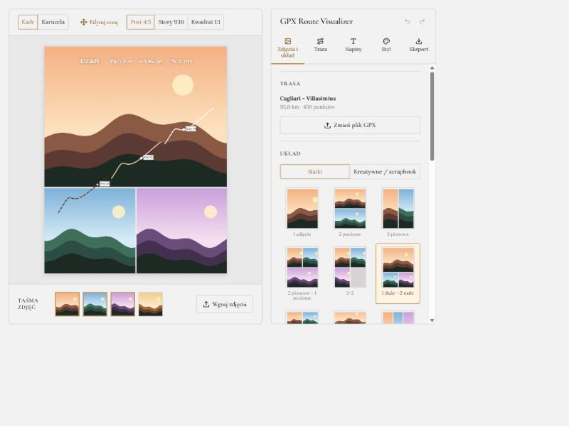
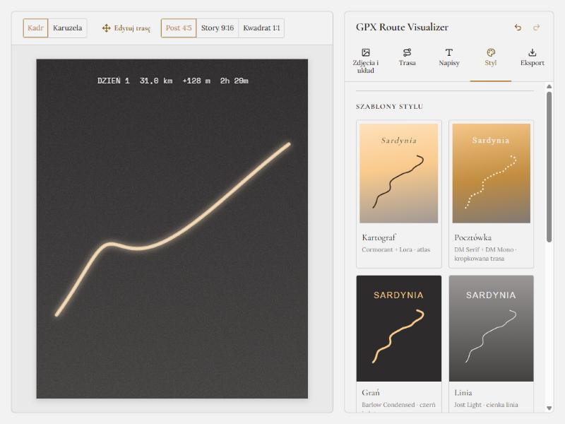
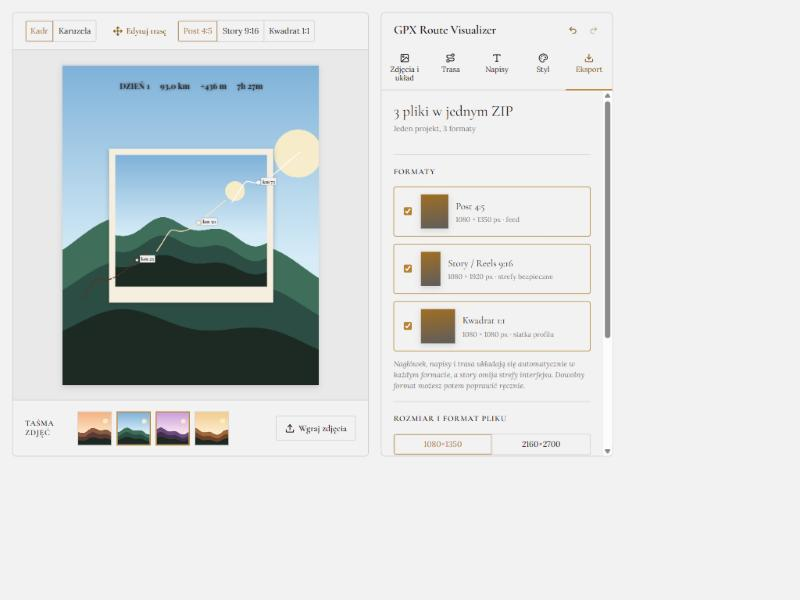
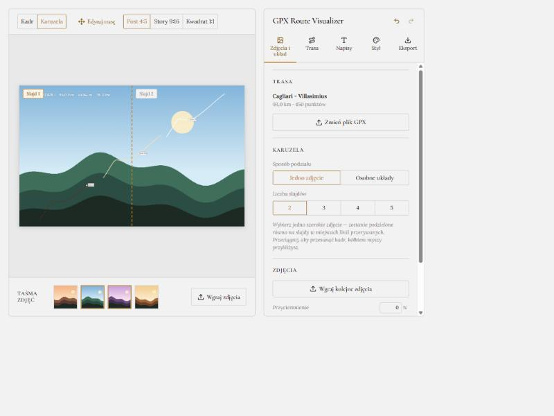

# GPX Route Visualizer

Edytor grafik na Instagrama dla osób, które wracają z wyprawy rowerowej, pieszej albo samochodowej. Z plików GPX
(Garmin, Strava, Komoot) i własnych zdjęć robi gotowe posty, story i karuzele: kolaż zdjęć, trasa narysowana na
wierzchu, nagłówek ze statystykami i własne napisy. Wszystko działa w przeglądarce, bez konta i bez wysyłania
zdjęć na serwer.



## Po co to jest

Relacja z wyprawy to zwykle kilka zdjęć i mapa z aplikacji treningowej. Złożenie z tego jednej, spójnej grafiki
wymaga zwykle kilku programów. Tutaj robisz to w jednym miejscu:

- **GPX jest opcjonalny.** Możesz zrobić sam kolaż ze zdjęć, a trasę dodać, gdy jest potrzebna.
- **Zdjęcia opcjonalne.** Bez zdjęć eksportujesz przezroczysty PNG z trasą, który nałożysz na zdjęcie w Instagramie.
- **Jeden projekt, wiele formatów.** Ten sam układ wychodzi jako post 4:5, story 9:16 i kwadrat 1:1.

## Co potrafi

**Zdjęcia i układy**
- Siatki (1–4 zdjęcia i warianty) oraz układy kreatywne w stylu scrapbooka z ramką polaroid.
- Przesuwanie i przybliżanie zdjęcia w slocie, tryb „całe zdjęcie” z rozmytym tłem, odstępy, marginesy, ramki.
- Taśma wgranych zdjęć: kliknij zdjęcie albo przeciągnij je na slot. Pliki można też upuścić prosto z dysku.

**Karuzela**
- Jedno szerokie zdjęcie dzielone równo na 2–5 slajdów albo osobny układ dla każdego slajdu.
- Trasa i napisy mogą przechodzić przez granice slajdów. Każdy slajd to osobny plik.

**Trasa**
- Kilka plików GPX jako kolejne dni, każdy z własnym kolorem i stylem linii.
- Trasa naturalna lub schematyczna (kąty proste), neon, przerywana linia, wybór fragmentu i postępu.
- Znaczniki kilometrów (co 10, 25 albo 50 km) i punkty zainteresowania: przełęcz, szczyt, punkt.
- Nagłówek ze statystykami: dystans, przewyższenie, czas (liczony osobno dla każdego dnia).

**Napisy i styl**
- Własne teksty z ponad 45 czcionkami pogrupowanymi tematycznie (w tym grupa „Do liczb i danych”), jedna czcionka dla całości jednym kliknięciem.
- Sześć szablonów stylu (Kartograf, Pocztówka, Grań, Linia, Noc, Dziennik): każdy z parą czcionek na tytuł, liczby i opisy, własnym wyglądem trasy, ramką i tłem. Można też zapisać własny.
- Tło kadru: kolor albo gradient (gotowe zestawy, kąt, ziarno filmowe, wygładzanie przejścia), z automatycznym kontrastem tekstu.



**Formaty i eksport**
- Post 4:5 (1080×1350), story 9:16 (1080×1920) i kwadrat 1:1 (1080×1080), także w 2× rozdzielczości.
- Każdy format ma własny układ: napisy i trasa układają się automatycznie, a w story omijają strefy interfejsu
  Instagrama. Elementy przesunięte ręcznie zachowują pozycję w danym formacie.
- Kilka formatów albo slajdów naraz trafia do jednego pliku ZIP. Jeden plik pobiera się bezpośrednio.





## Uruchomienie

Potrzebny jest Node.js.

```bash
npm install
npm run dev        # serwer deweloperski
npm test           # testy (Vitest)
npm run typecheck
npm run lint
npm run build
```

Plik `sample.gpx` w repozytorium to krótki przykład do wypróbowania.

## Technologie

React 19, TypeScript, Vite, Konva (react-konva) do rysowania sceny, Zustand do stanu z cofaniem i ponawianiem,
Vitest do testów. Czcionki są hostowane lokalnie (`@fontsource`).

## Architektura

- `src/store/` — Zustand podzielony na slices (`ui`, `media`, `route`, `stats`, `elements`, `templates`) i `history.ts`
  (undo/redo całego dokumentu). `DocumentState` w `store/types.ts` definiuje, co obejmuje historia.
- `src/store/derived.ts` — memoizowane obliczenia (projekcja, statystyki, podział postępu), `selectors.ts` — hooki.
- `src/utils/` — czyste funkcje domenowe z testami `*.test.ts`: parser GPX, geometria, układy zdjęć (`layouts`),
  przestawianie formatów (`reflow`), szablony (`templates`), eksport i ZIP (`exportImage`, `exportProject`, `zip`).
- `src/components/` — scena Konva (`CanvasStage`, `PhotoLayer`, `NeonRouteGroup`, `StatsHeaderGroup`…),
  `panel/` — zakładki panelu, `fields/` i `ui/` — wspólne kontrolki.

Zasady:

- Etykiety miejsc są zakotwiczone jako pozycja na śladzie (`trackPos`), nie piksele.
- Elementy tylko do edycji mają nazwę `ui-only` i są ukrywane przy eksporcie.
- Układ w formacie 4:5 jest wzorcem; pozostałe formaty są z niego wyliczane, a ręczne poprawki zapamiętywane osobno.
- W `localStorage` zapisywane są tylko preferencje wyglądu i własne szablony (`partialize` + `version`/`migrate`).
  Zdjęcia i trasy nie opuszczają przeglądarki.

## Skróty

| Skrót | Akcja |
| --- | --- |
| Ctrl+Z / Ctrl+Shift+Z, Ctrl+Y | cofnij / ponów |
| Delete | usuń zaznaczony tekst lub miejsce |
| Strzałki (+Shift) | przesuń zaznaczony element o 1 px (10 px) |
| Esc | anuluj dodawanie punktu / zakończ edycję trasy / odznacz / zamknij pasek zdjęcia |
| Dwuklik na tekście | edycja w miejscu (Enter zatwierdza, Esc anuluje) |
