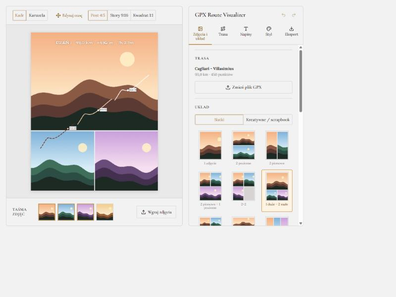
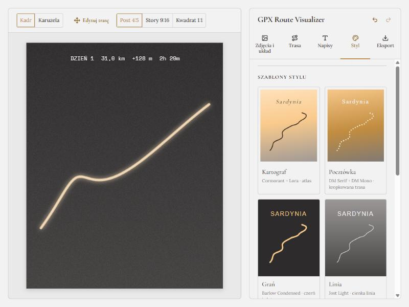
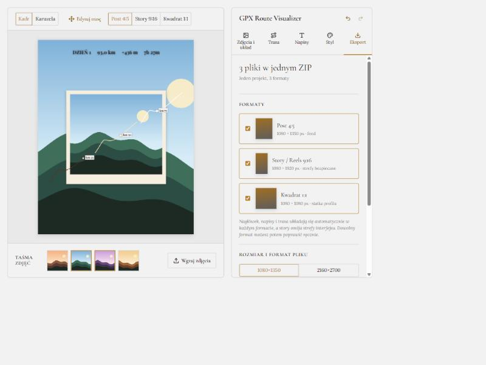
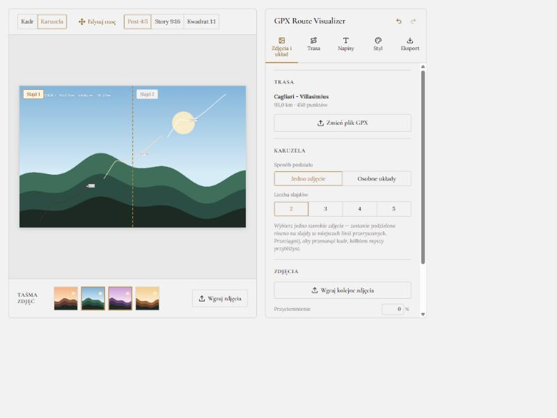

# Tripcard

A browser editor that turns a bike ride, hike, road trip or holiday into Instagram-ready graphics and short videos.
Load GPX files from Garmin, Strava or Komoot, or plan the trip from stops on a map, add your photos, and get posts,
stories, carousels and animated route videos: a photo collage, the route drawn on top, a stats header and your own
captions. Everything runs in the browser, with no account, and photos never leave your computer.

The interface is in Polish.



## Why

A trip write-up is usually a handful of photos and a map from a training app, and putting them together into one
coherent graphic takes several programs. Tripcard does it in one place:

- **GPX is optional.** Make a photo collage on its own and add the route when you need it, or plan the trip from
  stops on a map without any file.
- **Photos are optional.** With no photos you export a transparent PNG of the route to lay over a photo in Instagram.
- **One project, many formats.** The same design comes out as a 4:5 post, a 9:16 story, a 1:1 square and a 16:9 frame.

## Getting started

The start screen offers three kinds of project:

- **Aktywność** (activity): load a GPX file; speed, gradient, elevation profile and stats are worked out from it.
- **Podróż** (journey): pick places on a map and the means of travel between them; no file needed.
- **Same zdjęcia** (photos only): a collage or carousel with no map and no route.

`sample.gpx` in the repository is a short ride to try it with.

## Features

**Photos and layouts**
- Grids for 1–4 photos and their variants, plus scrapbook layouts with polaroid frames.
- Pan and zoom a photo inside its slot, a "whole photo" mode over a blurred fill, gaps, margins and frames.
- A strip of loaded photos: click a photo or drag it onto a slot. Files can also be dropped straight from the disk.
- A film look for photos (grade, lifted blacks, grain) and a palette picked from your photos.

**Carousels**
- One wide photo split evenly into 2–5 slides (panorama), or a separate layout per slide (series).
- The route and captions can run across slide borders. Each slide is its own file.

**Route**
- Several GPX files as consecutive days, each with its own colour and line style.
- A natural or schematic (right-angled) line, neon, dashed, hand-drawn, outlined or as a sticker, with the rest of
  the route faded; choose the visible part and the drawing progress.
- Colour along the route by elevation, gradient, speed or heart rate, with a legend.
- Kilometre markers (every 10, 25 or 50 km) and places along the route with names, photos or one of 23 hand-drawn
  icons.
- An elevation profile and a stats header: distance, elevation gain, moving time, speed (per day where it applies).

**Map background**
- Map styles from OpenFreeMap (light, colourful, bold, dark, fiord) and Esri satellite imagery, with labels and
  hill shading, or recoloured from the current style.
- A hand-drawn **sketch** map: coastlines, lakes, rivers, roads and towns from OpenStreetMap, drawn with a trembling
  pen. Paper, roads and rivers, place names, the coastline and the water's marking (hatching, watercolour or
  none) can each be switched.
- Moods that fade, tint or blur the map; a map sticker cut to the route's shape.

**Journey planning**
- Search for places (Photon), click them on the map and reorder them.
- Travel by car, bike, on foot, by train or by plane. A leg follows the roads (BRouter), runs straight or curves as
  an arc; flights take the great-circle arc.

**Text and style**
- Captions in 53 self-hosted fonts grouped by theme, one font for everything in a click.
- Text on a curve (wave, arc, bulge), outlines, hard shadows, typing animation, badges and route captions.
- 26 style templates in six groups (basic, natural, retro, dark, stickers, posters). A click previews a template
  on the frame; apply it whole or only some of its parts (fonts, route, frame, colours, layout, places, effects,
  photo look). Save your own.
- Backgrounds: transparent, a colour, a gradient (presets, angle, film grain, smoothing) or a map, with automatic
  text contrast. Frames around the whole design: postcard, stamp, postmark, ticket and album; a date stamp and a
  kicker line.

**Animation and video**
- The route draws itself over time, with the header, places and stats coming in on a timeline you can edit.
- Pacing: constant, eased or by the recorded speed; a marker at the line's end.
- Camera: static, following, fly-over or panorama.
- Video export as MP4, WebM, GIF or a ZIP of transparent PNG frames (for DaVinci or Premiere), up to 4K, with an
  optional postcard inset in a corner.

**Formats and export**
- Post 4:5 (1080×1350), story/reels 9:16 (1080×1920), square 1:1 (1080×1080) and 16:9 (1920×1080), also at 2×.
- Each format has its own layout: captions and the route lay themselves out, and the story avoids Instagram's
  interface. Anything moved by hand keeps its place in that format.
- The download dialog shows the real design in every format. Several formats or slides go into one ZIP; a single
  file downloads directly.







## Running it

You need Node.js.

```bash
npm install
npm run dev        # development server
npm test           # tests (Vitest)
npm run typecheck
npm run lint
npm run build
```

## Stack

React 19, TypeScript, Vite, Konva (react-konva) for the scene, Zustand for state with undo and redo, MapLibre GL for
map tiles, Mediabunny and gifenc for video, Vitest for tests. Fonts are self-hosted (`@fontsource`) and load only
when used; the map library and the video muxer load on demand too.

## Architecture

- `src/store/` — Zustand split into slices (`ui`, `media`, `route`, `routeSource`, `stats`, `elements`, `series`,
  `templates`) and `history.ts` (undo/redo of the whole document). `INITIAL_DOCUMENT` in `store/document.ts` is the
  one list of what a document is: history, the export snapshot and the template preview all take their keys from it.
- `src/store/derived.ts` — memoised calculations (projection, stats, progress split); `selectors.ts` — hooks.
- `src/features/` — self-contained features (animation, camera, data colouring, elevation profile, map, map
  sticker, stamp, kicker, stats, travel, video export). Each registers its panel sections, canvas elements and
  store slice through the registries in `src/core/`, so the app does not import them directly.
- `src/core/` — the shared engine: formats, canvas element registry, route geometry and painting, background
  kinds, the export frame source and the panel registry.
- `src/services/video-encoding/` — the video encoding service behind a port, with a fake for tests.
- `src/utils/` — pure domain functions with `*.test.ts` tests: GPX parser, geometry, photo layouts, format reflow,
  templates, frames (`wrappers/`), export and ZIP.
- `src/components/` — the Konva scene (`CanvasStage`, `PhotoLayer`, `RouteGroup`…), `panel/` for the panel tabs,
  `fields/` and `ui/` for shared controls.

Rules:

- Place labels are anchored as a position on the track (`trackPos`), not as pixels.
- Editor-only elements are named `ui-only` and hidden when exporting.
- The 4:5 layout is the source; the other formats are derived from it and manual changes are stored per format.
- Only look-and-feel preferences and your own templates are kept in `localStorage` (`partialize` +
  `version`/`migrate`). Photos and routes never leave the browser.

## Shortcuts

| Shortcut | Action |
| --- | --- |
| Ctrl+Z / Ctrl+Shift+Z, Ctrl+Y | undo / redo |
| Delete, Backspace | delete the selected element |
| Arrows (+Shift) | move the selected element by 1 px (10 px) |
| Esc | leave a template preview / stop adding a place / finish editing the route / deselect |
| Double-click on text | edit in place (Enter confirms, Esc cancels) |
| ← / → | previous / next slide in a series |
| Ctrl+D | duplicate the current slide in a series |
| Delete (no selection) | remove the current slide in a series |

## Map data

Map tiles, the sketch's features and place search come from OpenFreeMap and OpenStreetMap, satellite imagery from
Esri World Imagery (non-commercial use with attribution), and routing from BRouter. The map's credit stays on the
graphic, as its licence requires; it can be moved, resized and recoloured.
